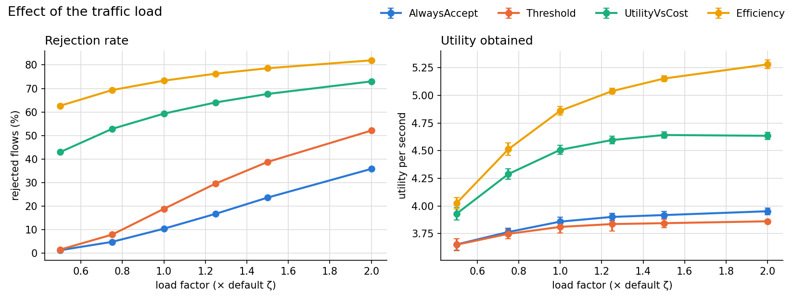
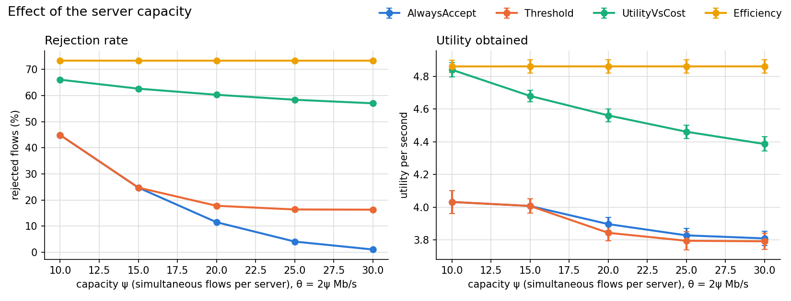
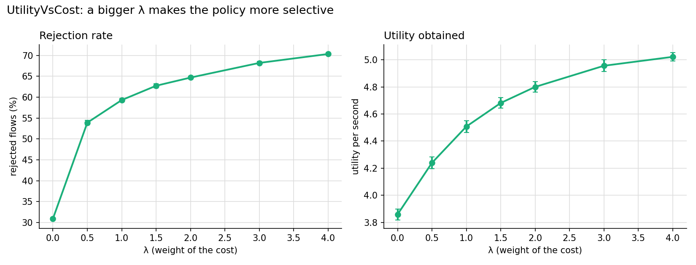
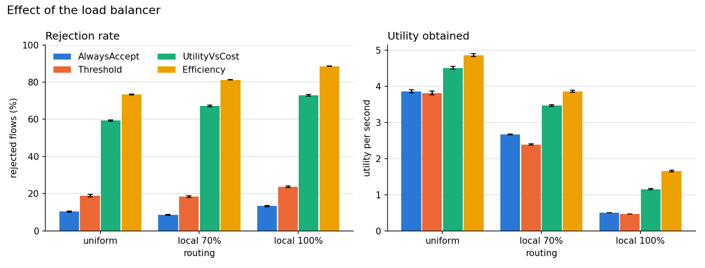

# AMS Admission Control Simulator

A Python-based discrete-event simulation project for evaluating **flow admission control policies in edge computing environments**. The simulator compares how different admission decisions affect flow rejection, accumulated utility, and server resource usage.

## Project objectives

- Simulate flows arriving from multiple areas and being routed to servers.
- Evaluate admission decisions subject to server capacity and access-link bandwidth constraints.
- Compare admission policies under different traffic and infrastructure configurations.
- Produce reproducible experiments, plots, and CSV results.

## Admission control policies

| Policy | Decision rule |
| --- | --- |
| **AlwaysAccept** | Accept whenever the simulator's resource constraints permit. |
| **Threshold** | Accept when the server's active-flow occupancy is below a configured threshold `T`. |
| **UtilityVsCost** | Accept when the flow's reward exceeds `λ` times the projected access-link utilization. |
| **Efficiency** | Accept when reward per unit of flow bitrate meets threshold `η`. |

The simulator enforces server constraints independently of the policies' decisions.

## Project structure

```text
.
├── main.py            # Compare four policies on the default scenario
├── Experiments.py     # Run experiments and export plots/CSV
├── config.py          # Default simulation configuration
├── simulator.py       # Simulation engine
├── policies.py        # Admission control policies
├── server.py          # Server model
├── traffic.py         # Traffic-related logic
├── balancer.py        # Load balancing logic
├── application.py     # Application-related logic
├── Scenarios.py       # Scenario code
├── Percentage.py      # Additional analysis
├── tests.py           # Project tests / checks
└── figures/           # Generated figures and CSV results
```

## Requirements

- Python 3
- `matplotlib` (for experimental plots)

Install the plotting dependency:

```bash
python -m pip install matplotlib
```

Other dependencies may be required by additional modules; inspect their imports if needed.

## Running the simulator

Run a comparison of the four policies using the default configuration:

```bash
python main.py
```

The console output includes rejection rate, utility per second, average server occupancy, and average bandwidth usage.

Run the experimental analysis:

```bash
python Experiments.py
```

**Note:** the filename is case-sensitive on Linux and macOS (`Experiments.py`, with a capital `E`).

The experiment script saves plots to `figures/` and writes numerical results to `figures/resultats.csv`.

## Experiments

The experimental script compares policies across four dimensions:

1. **Traffic load:** scale flow arrival rates relative to the default configuration.
2. **Server capacity:** vary maximum concurrent flows and corresponding access-link capacity.
3. **Utility-versus-cost trade-off:** vary the `λ` parameter of `UtilityVsCost`.
4. **Load balancing:** compare uniform routing with routing that favors the local server.

For each data point, the script runs **five replications** with different random seeds by default (`R = 5`) and reports mean rejection rate and utility per second with **95% confidence intervals** based on Student's t-distribution.

### Example plots

**Effect of traffic load**



**Effect of server capacity**



**Utility-versus-cost parameter**



**Load-balancing strategies**



## Configuration

The default scenario is defined in `config.py`. It includes flow arrival rates, flow durations, bitrates, server capacities, routing probabilities, simulation horizon, warm-up period, and random seed.

Adjust the parameters to study alternative scenarios. For faster experiments, reduce the number of replications `R` in `Experiments.py`.

## Research context

This is an academic simulation project exploring admission control in edge computing. Some policy choices and parameter notation are based on or inspired by research by Fox et al. The precise paper citation can be added here.

## Scope

This repository provides a **simulation and comparative evaluation**, not a production edge-computing deployment. The figures illustrate experimental outputs and should be interpreted in the context of the configured scenarios.
